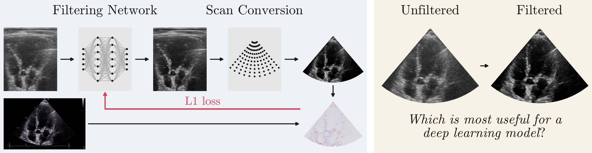
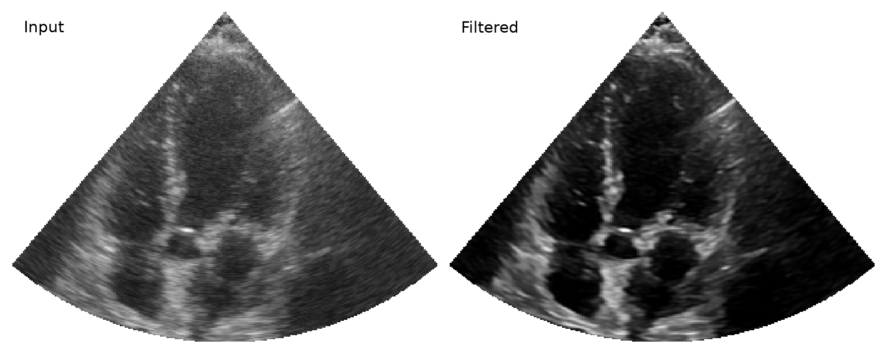

<h1 align="center">Does Vendor Image Processing Matter? Learning Echocardiography Display Appearance from Native Beamspace Data</h1>

<p align="center">
  <a href="https://arxiv.org/abs/2611.00184"></a>
  <a href="https://huggingface.co/datasets/Ahus-AIM/EchoXFlow"></a>
  <a href="https://github.com/Ahus-AIM/EchoAppearance/actions/workflows/ci.yml"></a>
</p>



## Overview

We share a network that reproduces the visual appearance of proprietary filtering
of echocardiography data. The network can improve the visual appearance of B-mode
echocardiography images. Applying the filter might also harm some downstream deep
learning systems, as demonstrated when segmentation models trained on unfiltered
inputs are evaluated after filtering. We also show
subjective improvements to the appearance of samples from the CAMUS dataset.

## Potential use cases

- Data augmentation
- Evaluating the effect of postprocessing on downstream learning
- Prettier illustrations of ultrasound data

## Installation

Install [uv](https://docs.astral.sh/uv/getting-started/installation/), then:

```bash
git clone https://github.com/Ahus-AIM/EchoAppearance.git
cd EchoAppearance
uv sync --frozen --extra plot
```

## Quick start

The pretrained filter and one 32-frame EchoXFlow tensor are included:

```python
import matplotlib.pyplot as plt
from image_enhancement import load_example_recording, load_filter, scan_convert
from image_enhancement.tensor import full_sector_grid

recording = load_example_recording()  # (32, 732, 242), with geometry and timestamps
model = load_filter()
filtered = model(recording.frames)    # (32, 732, 242)

grid = full_sector_grid(recording.geometry, output_size=(256, 256))
fig, axs = plt.subplots(1, 2, figsize=(8, 3.5), layout="constrained", facecolor="none")
for i, frames in enumerate((recording.frames, filtered)):
    frame = scan_convert(frames[0], recording.geometry, grid=grid,
                         display_head=model.display_head if i else None,
                         outside=float("nan"))
    axs[i].matshow(frame.cpu().numpy(), cmap="gray", vmin=0, vmax=1,
                  aspect=grid.dz_m / grid.dx_m)
    axs[i].text(0.03, 0.97, ("Input", "Filtered")[i], transform=axs[i].transAxes,
                va="top", bbox=dict(facecolor="white", alpha=0.65, edgecolor="none"))
    axs[i].set_axis_off()
plt.show()
```



The native forward pass preserves shape. The Cartesian head is applied after scan conversion.
Inputs are native uint8, or float32 brightness in [0, 1].

## Experiments

- `experiments/segmentation/`: matched training on EchoXFlow and CAMUS, `matched.py` (prepare and train), `cross_eval.py` (cross-domain evaluation), `cross_table.py` (results table).
- `experiments/camus/`: CAMUS example figure.

## Licence

The code, weights, example data and figures all use
[CC BY-NC-SA 4.0](LICENSE). The model was trained on EchoXFlow.
See the [model card](weights/README.md).

## Citation

**Please cite both articles** when using this model: EchoAppearance was trained
on EchoXFlow. The EchoAppearance preprint is
[arXiv:2611.00184](https://arxiv.org/abs/2611.00184).

```bibtex
@misc{stenhede_echoappearance,
  title = {Does Vendor Image Processing Matter? Learning Echocardiography Display Appearance from Native Beamspace Data},
  author = {Stenhede, Elias and Ranjbar, Arian},
  year = {2026},
  eprint = {2611.00184},
  archivePrefix = {arXiv},
  primaryClass = {eess.IV},
  url = {https://arxiv.org/abs/2611.00184}
}

@inproceedings{stenhede_2026_echoxflow,
  title = {EchoXFlow: A Beamspace Echocardiography Dataset for Cardiac Motion, Flow, and Function},
  author = {Stenhede, Elias and Sulkowska, Joanna and Orstad, Eivind Bj{\o}rkan and Schirmer, Henrik and Ranjbar, Arian},
  booktitle = {Advances in Neural Information Processing Systems (NeurIPS), Evaluations and Datasets Track},
  year = {2026},
  eprint = {2605.05447},
  doi = {10.48550/arXiv.2605.05447},
  url = {https://arxiv.org/abs/2605.05447}
}
```
